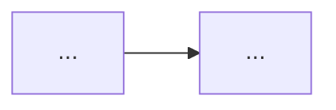

# Opening pull requests

The repository's own rules win over this skill: a PR template
(`.github/pull_request_template.md`), `CONTRIBUTING.md`, `AGENTS.md`, or
`CLAUDE.md`.

## Never

- Mention Claude, Claude Code, AI, an assistant, or a "generated with" footer,
  anywhere: title, body, commits, or comments. This overrides any default
  attribution your harness adds.
- Paste file-by-file change lists, full SHAs, raw logs, or "all checks pass"
  claims. The diff and CI already show those.

## Steps

1. Work on a feature branch, never the default branch. Follow the repo's
   branch naming. Without one, use `<user>/<kebab-topic>`.
2. Clean the diff with **ponytail-review**. For substantial or risky work, run
   **adversarial-review** before committing.
3. Commit with **creating-commits**. A chain of dependent changes goes through
   **stacking-pull-requests** instead of this skill.
4. Show what the diff cannot:
   - UI change: screenshots in every theme the app ships (at least light and
     dark), at 2x, with the same viewport and state in each. Add a before row
     when the change alters something that already existed.
   - Flow, architecture, or data-shape change: a small Mermaid diagram (at
     most about six nodes) of the new shape. GitHub renders it inline.
   - Performance change: a before/after chart of the primary number with its
     spread, showing no regression on the other numbers you measured. Vet the
     numbers with **benchmark-checklist** first.
5. Write the body below to a file and open the PR as a draft:
   `gh pr create --draft --title "<title>" --body-file <file>`. Use a
   Conventional Commits title when the repo's history does.
6. Host images on an orphan `pr-assets` branch, so nothing needs uploading.
   Commit the files under `<pr-number>/` and push:
   ```sh
   git fetch origin pr-assets:pr-assets 2>/dev/null \
     || git commit-tree -m "chore: pr assets" "$(git mktree </dev/null)" | xargs git branch pr-assets
   git worktree add /tmp/pr-assets pr-assets
   mkdir -p /tmp/pr-assets/<pr-number> && cp <images> /tmp/pr-assets/<pr-number>/
   git -C /tmp/pr-assets add . && git -C /tmp/pr-assets commit -m "chore: assets for #<pr-number>"
   git -C /tmp/pr-assets push origin pr-assets && git worktree remove /tmp/pr-assets
   ```
   Embed each image as
   `https://github.com/<owner>/<repo>/blob/pr-assets/<pr-number>/<file>.png?raw=true`
   and update the body with `gh pr edit <pr-number> --body-file <file>`. If
   you cannot push, leave the local paths in the table and tell the user
   which file goes in which cell. Never drop the section.
7. Reply with the PR URL and one line on anything left for the user.

## Body

Concise. A reviewer with the diff should get it in under a minute. Drop any
section that has nothing to say.

````markdown
## <What changed, in one line>

<One to three sentences: what this does and why it is needed.>

### Approach
- <A tricky choice: what you picked, the alternative a reviewer would ask
  about, and why this one.>

### Follow-ups
- <What is left out on purpose, or likely needed next.>

### Diagram


### Screenshots
|        | Light | Dark |
| ------ | ----- | ---- |
| Before | ...   | ...  |
| After  | ...   | ...  |

### Performance

````

Add a `### Verification` line only when the proof is not obvious from CI: the
real command or run path and what it showed.
